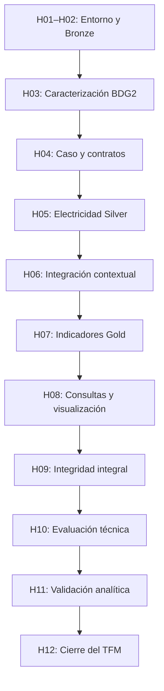

# Plan de hitos técnicos y seguimiento en GitHub

## Finalidad y situación de partida

Este documento establece la **planificación técnica propuesta** para el TFM y
relaciona los objetivos específicos OE1–OE7 con entregables verificables. No
constituye un informe de resultados ni sustituye el calendario de entregas
académicas acordado por el equipo.

La situación inicial se describe en el [`README.md`](../README.md) y en la
[`guía de los hitos 1 y 2`](hitos-1-2.md): entorno local Spark/Delta verificado
y capa Bronze implementada con pruebas de software sobre datos sintéticos. Los
hitos posteriores están **planificados**, pero todavía no se consideran
implementados, probados ni aprobados. La caracterización preliminar de BDG2
incluida en la memoria deberá contrastarse con los CSV originales locales.

## Catálogo de hitos

Los títulos de la segunda columna son los propuestos para los *milestones* de
GitHub. Su creación o cierre en GitHub no acredita por sí sola la finalización
técnica de un hito.

| ID | Título del milestone en GitHub | Resultado esperado | Objetivos del TFM | Dependencia | Situación |
| --- | --- | --- | --- | --- | --- |
| H01 | `H01 - Entorno local Spark y Delta` | Entorno reproducible y comprobación efectiva de escritura y lectura Delta | OE2, OE3 | Ninguna | Implementado; verificación documentada |
| H02 | `H02 - Ingesta Bronze y trazabilidad` | Conservación de fuentes, snapshots Delta e inspección de versiones publicadas | OE2, OE3, OE6 | H01 | Implementado; pruebas sintéticas |
| H03 | `H03 - Caracterización de las fuentes BDG2` | Procedencia, estructura, cobertura e incidencias verificadas sobre fuentes locales | OE1 | H02 para comparar con Bronze | Planificado |
| H04 | `H04 - Selección del caso y contratos analíticos` | Selección justificada y contratos de Silver, calidad e integración aprobados | OE1, OE2, OE4 | H03 | Planificado |
| H05 | `H05 - Silver de electricidad y calidad` | Electricidad en formato largo, trazable y con indicadores de calidad | OE3, OE4 | H04 | Planificado |
| H06 | `H06 - Integración de metadatos y meteorología` | Enriquecimiento contextual validado y asociación meteorológica justificada, si procede | OE3, OE4 | H05 | Planificado |
| H07 | `H07 - Indicadores Gold y comparativas` | Agregaciones por periodo, cobertura e indicadores normalizados válidos | OE3, OE5 | H06 o decisión sin meteorología | Planificado |
| H08 | `H08 - Consultas y visualización analítica` | Consultas y visualizaciones locales para tareas de análisis definidas | OE5, OE7 | H07 | Planificado |
| H09 | `H09 - Integridad y recuperación integral` | Consistencia entre capas, reejecución y recuperación ante fallos | OE3, OE6 | H05–H08 | Planificado |
| H10 | `H10 - Evaluación técnica controlada` | Medidas reproducibles de rendimiento y comportamiento ante distintos volúmenes | OE6 | H09 | Planificado |
| H11 | `H11 - Validación funcional y analítica` | Indicadores contrastados y evaluación de tareas representativas | OE4, OE5, OE7 | H08–H10 | Planificado |
| H12 | `H12 - Reproducibilidad y cierre del TFM` | Documentación, evidencias, limitaciones y revisión final coherentes | OE1–OE7 | H11 | Planificado |

Los estados reflejan la evidencia disponible en el repositorio, **no** el
estado de GitHub. El cierre de H01 y H02 deberá revisarse antes de darlos por
completados en la herramienta de seguimiento.

## Secuencia principal

El diagrama representa las principales condiciones de avance. Las pruebas,
la revisión de resultados y la documentación se realizan durante todo el
proyecto. Algunas inspecciones de solo lectura pueden solaparse. La inclusión
de una actividad en esta planificación no autoriza automáticamente su ejecución.

## Guías detalladas

| Hito | Documento |
| --- | --- |
| H01–H02 | [`hitos-1-2.md`](hitos-1-2.md) |
| H03 | [`hitos-3.md`](hitos-3.md) |
| H04 | [`hitos-4.md`](hitos-4.md) |
| H05 | [`hitos-5.md`](hitos-5.md) |
| H06 | [`hitos-6.md`](hitos-6.md) |
| H07 | [`hitos-7.md`](hitos-7.md) |
| H08 | [`hitos-8.md`](hitos-8.md) |
| H09 | [`hitos-9.md`](hitos-9.md) |
| H10 | [`hitos-10.md`](hitos-10.md) |
| H11 | [`hitos-11.md`](hitos-11.md) |
| H12 | [`hitos-12.md`](hitos-12.md) |

## Responsabilidades

- **Carlos:** arquitectura Spark/Delta, procesos, persistencia, trazabilidad,
  reproducibilidad, recuperación y evaluación técnica.
- **Irantzu:** caracterización BDG2, selección del caso, modelo analítico,
  reglas de calidad, integración contextual, indicadores y validación analítica.
- **Ambos:** aprobación de contratos entre capas, revisión cruzada,
  interpretación de resultados y validación de la memoria.

Estas atribuciones son ámbitos de responsabilidad y no equivalen a asignaciones
automáticas a cuentas de GitHub.

## Condiciones generales para cerrar un hito

1. Alcance, dependencias, responsables, contratos y criterios de aceptación
   aprobados antes de implementar cambios sustanciales.
2. Documentación pública en **español de España**; código, identificadores,
   pruebas, docstrings y comentarios técnicos necesarios en **inglés**.
3. CSV originales BDG2 inalterados y excluidos de Git; entradas y salidas
   separadas. Las pruebas sintéticas no acreditan conclusiones energéticas.
4. Pruebas pertinentes realmente ejecutadas, con comando, revisión de código,
   entorno, resultados y comprobaciones no realizadas.
5. Estado de la evidencia declarado con precisión: **diseñado**,
   **implementado**, **probado con datos sintéticos**,
   **validado con BDG2 real** o **medido**.
6. Anomalías, registros excluidos, versiones, linaje, recuperación y límites
   de comparabilidad documentados cuando correspondan.
7. Revisión cruzada de decisiones analíticas y afirmaciones de la memoria.
   Los cambios de archivos deben acompañarse de una propuesta de mensaje
   siguiendo Conventional Commits; no se realizan commits ni publicaciones
   remotas sin petición expresa.

## Uso de milestones e issues en GitHub

Crear un *milestone* por resultado técnico aceptado y dividir su trabajo en
*issues* pequeños y verificables. Los títulos recomendados figuran en la tabla
anterior y las tareas sugeridas, en cada guía de hito.

El archivo [`github-milestones.json`](github-milestones.json) contiene 12
objetos independientes con `title`, `state` y `description`, preparados para
una futura creación mediante la API de GitHub. **No crea hitos por sí mismo**;
antes de utilizarlo es necesario revisar los milestones existentes para evitar
duplicados. Tampoco debe enviarse el array completo como si fuera un único
milestone.

Recomendaciones de seguimiento:

- Mantener una única responsabilidad clara por issue y revisar las
  dependencias antes de iniciarlo.
- Incorporar el prefijo `[H03]`, `[H04]`, etc. al título de las tareas.
- No establecer fechas ficticias: deben aprobarse según el calendario real
  de entregas académicas.
- Cerrar cada issue con sus pruebas y evidencias; cerrar un milestone
  únicamente cuando se hayan satisfecho todos los criterios obligatorios.
- Registrar por separado los bloqueos que necesiten una decisión conjunta.

Las definiciones incluidas aquí **no significan que ya existan milestones
o issues creados en GitHub**.

## Siguiente actividad recomendada

**`[H03] Verificar rutas, variantes y huellas de los CSV originales BDG2`**.

Comenzar mediante un diagnóstico de solo lectura. Confirmar la procedencia y
el contenido de los archivos locales antes de aprobar selecciones de edificios,
reglas analíticas o desarrollo Silver. Los criterios se detallan en
[`hitos-3.md`](hitos-3.md).
